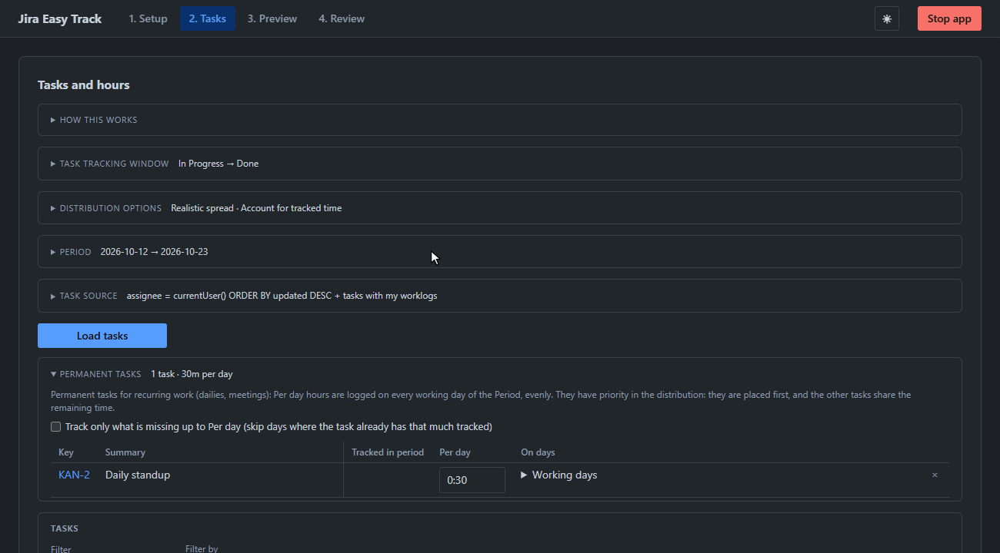

# Jira Easy Track

Tired of tracking your jira time, splitting the task time between days manually?
Here is a simple Jira time tracker: one Python file, zero dependencies. **No activity monitoring**, no background agent, no screenshots, no window or keystroke tracking, no timers running all day.

You tell it how many hours you spent on each task, and it spreads them across your working days and logs them to Jira, when you decide.



## How it works

1. **Setup**: enter your Jira Cloud URL, email and [API token](https://id.atlassian.com/manage-profile/security/api-tokens) and press **Test and save** (the required Jira permissions are listed in a collapsed hint under the token field). Here you also set the working day (start/end, an optional break, step of 5-60 minutes) and the working weekdays, and can save everything to a config file.
2. **Tasks**:
   - **Period**: dates "From" and "To", plus optional days off / holidays and extra working days (`YYYY-MM-DD`, comma-separated).
   - **Task source**: an editable JQL (default: assigned to you), a checkbox to also add the tasks you tracked time on in the period (they are listed even outside the tracking window filter), and the fields to display (Key and Summary by default) and adding a task by key (**Add task** puts it in the list, **Add permanent task** in Permanent tasks). Press **Load tasks** to fetch them.
   - For each task set:
     - **Tracked in task**: all time logged on the task in Jira (by anyone, read-only), followed by the task's original estimate if it has one, e.g. `11h (14h estimate)`.
     - **To track** hours, spread over the working days of the period (if left empty, nothing is tracked).
     - **Timing**: towards the start (default) / middle / end, even, or random. With **Realistic spread** the hours per day are shuffled a bit on top of that.
     - **Range**: **Task window** (only the days inside the task's tracking window) or **Whole period**.
     - **Tracking window**: the dates of the task's window (`from – to`, or a single date if both are the same day; `from – now` if the task has not reached status 2 yet). Shown only when Range is **Task window**.
   - **📌** at the right edge of a task row pins it: pinned tasks stay in the list (even outside the filters), move to the top and are separated from the rest by a line. **Add task** pins too. Pinned tasks are saved to the config file.
   - **Permanent tasks** (collapsible, above the list) are for recurring work such as dailies and meetings. They are added only by key with **Add permanent task** in Task source (× removes one). Columns: Key, the displayed fields, **Tracked in period** (your own time on the task in the period) and **Per day**: those hours are logged evenly on every working day of the period (Timing is Even, Range is Whole period), and **On days**, a dropdown with checkboxes to limit Per day to certain weekdays (default: all working days from the Setup schedule). They have priority in the distribution: their time is placed first, and the other tasks are spread over the time that remains. A checkbox makes the calculation track only what is missing up to Per day: days where the task already has that much tracked are skipped. They are saved to the config file with their Per day hours and loaded on start; **Load tasks** fills the list below.
   - Hours formats: `8`, `1.5`, `1:30`, `1h 30m`, `45m`.
   - The filter box narrows the list by any displayed field; **only with hours** hides tasks without hours. **Clear data** removes loaded tasks, entered hours, cached history and the current distribution from the browser.

   Then press **Calculate distribution**. 
   Collapsible sections on this page:
   - **Task tracking window**: a task is tracked only between its first move into status 1 (default `In Progress`) and its first move into status 2 (default `Done`), inside the selected period. Both statuses are picked from your Jira's status list (**Load statuses**). A checkbox (on by default) lists only tasks whose window overlaps the selected period. When tasks are loaded, their status history is read and **Range** is preset: Task window if the task has such a transition, Whole period otherwise. You can change it per task.
   - **Distribution options**: optionally enable a realistic spread so different days get different hours, and/or **account for already tracked time**: your worklogs already in Jira for the period keep their time slots free, so new worklogs do not overlap them. To track is always added in full.
3. **Preview**: review the generated distribution as a table (tasks by days) or a list (by days), remove entries or whole cells you don't want, then approve to push the worklogs to Jira. While sending, the button shows the progress, and clicking it again stops sending; failed or remaining entries can be sent in the next run.
4. **Review**: find your own worklogs for a period (**Find my worklogs**) as a table (tasks by days, default) or a list, and delete what you don't need:
   - click a table cell, or the × next to a worklog in the list, to delete it right away; click it again (↺ in the list) to restore it with the same start, duration and comment;
   - click a day in the Total row to delete all worklogs of that day (asks first);
   - **Delete all found**, above the results, deletes everything found (asks first). While deleting or restoring is running, it shows the progress, and clicking it again stops the process.

   The Review period is set to the Tasks period on every start, then it is changed independently.

## Quick start

Requires Python 3.8+.

```
python jira-track.py
```

The browser opens at `http://127.0.0.1:4777` (set `JIRA_TRACK_PORT` to change it; a free port is picked if it is busy; `--no-open` skips opening the browser). Press `Ctrl+C` in the terminal or the **Stop app** button to quit.

The 🌙/☀ button in the header switches between the light and dark theme. By default the system preference is used; the choice is remembered in the browser.

## Config file (optional)

The **Save to config file** button stores the connection, JQL, displayed fields, permanent tasks (with their per day hours), pinned tasks (📌 or **Add task**), working day settings (including the distribution options) and the tracking window statuses in `jira-track.config.json` next to the script. Once saved, it is loaded on every start and kept up to date automatically. Set `JIRA_TRACK_CONFIG` to use a different path.

The token is stored in plain text, so the config file is excluded via `.gitignore`. Do not commit or share it.

## Notes

- A tiny local server (bound to `127.0.0.1` only) serves the UI and proxies requests to Jira, because Jira Cloud blocks direct browser calls (CORS). Nothing is sent anywhere except your Jira site.
- Without a config file, the token is kept only in the browser's localStorage and sent to Jira through the local server.
- Jira Cloud only (REST API v3). Worklogs are created without changing the issue's remaining estimate.
- Times use your browser's time zone.
